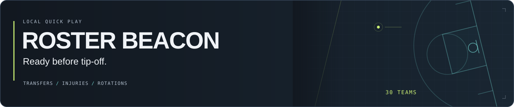
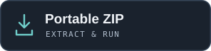
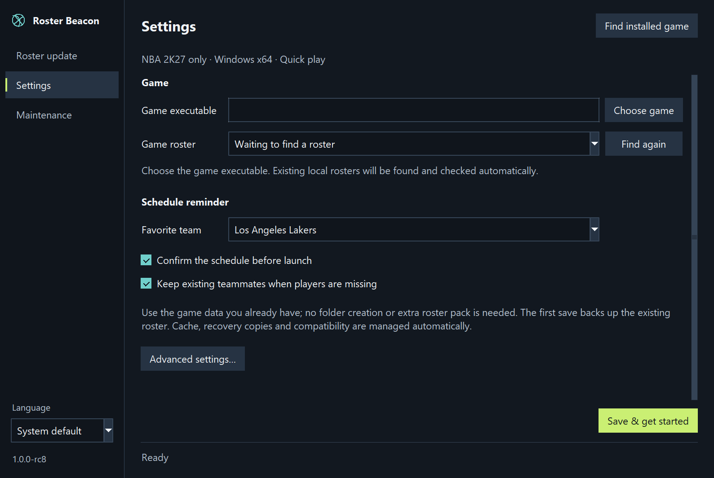
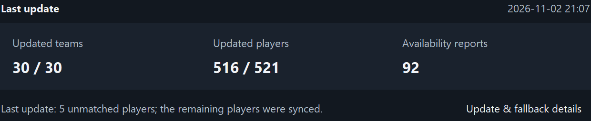
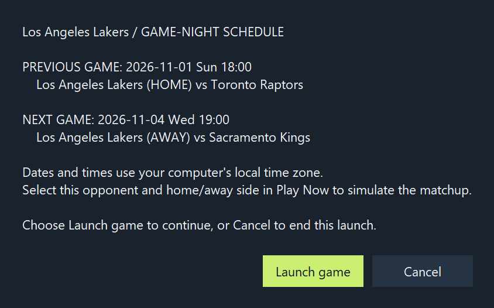

**English** · **[简体中文](README.zh-CN.md)**

Update transfers, availability and rotations before you play. One workflow for all 30 teams.

**NBA 2K27 · Windows 10/11 x64 · Quick play only**  
Independent utility. Other game editions and platforms are unsupported; Steam discovery/launch are implemented, while Steam in-game adoption remains unverified.

[rc10 release, source & checksums](https://github.com/c01-in/roster-beacon/releases/tag/v1.0.0-rc10) · [Setup guide](docs/SETUP.md) · [Source & usage risks](#data-source-local-requests-and-usage-risks)

Actual rc8 initial setup. Choose the game; cache, recovery copies and compatibility are managed for you. Personal paths are not shown.

## From install to tip-off

1. **Choose your game.** Install the tool or extract the whole portable ZIP, then find the installed game or choose `NBA2K27.exe`.
2. **Save & get started.** Existing local rosters are found and checked automatically. If several compatible saves remain, choose yours; the first save creates its recovery copy.
3. **Update, then play.** Choose **Update only** or **Update & launch**. Read the first-use source notice, then confirm the matchup reminder if enabled.

You do not create a SYNC folder, select a cache path or install an extra roster pack. If no usable roster exists, open the game, reach its main menu, exit and choose **Find again**. The game can remain disconnected from 2K servers; the computer needs internet access to the configured data source.

## One workflow. All 30 teams.

| On the court | Under the hood |
| --- | --- |
| **Transfers and availability** | Update uniquely matched real players, injuries and suspensions across the league. |
| **Starters and bench order** | Build position-based lineups from the source depth chart; exclude Out/suspended players from newly built active rotations. |
| **Your next matchup** | See the selected team's previous and next games before launch, with opponents and home/away sides. |
| **Recovery managed for you** | Back up existing data, check integrity before committing, and block launch when updating fails. Normal settings saves keep the recovery copy. |

### See what changed — and what stayed unchanged

Detail from a real saved local run on November 2, 2026 (Pacific time). Counts vary with the local roster and source; this is not a live status display.

### Pick a matchup before the game opens

Saved schedule example from the same run, replayed in the actual rc8 dialog. It is not a live fixture feed. Dates/times shown use Pacific time.

## Existing rosters, sensible fallback

The tool uses the game's existing compatible **unencrypted SYNC RDAT v9** data. RDAT v9 is a format, not a pack to download. No game files, roster packs, faces, models or player records are bundled or fabricated.

Missing source players can be covered by retained real teammates. If a team has no matches or cannot form a safe lineup, its previous roster can be preserved and related transfers deferred to prevent duplicates. Retained data is reported separately from updates; it remains an older snapshot. Strict mode stops on missing players. Corrupt inputs, unsupported layouts and source failures still stop the operation.

**Quick play only:** MyCareer, MyNBA/franchise/season saves and live in-game editing are unsupported. Advanced manual paths/imports and compatibility settings remain available under **Advanced settings**. To add genuinely missing records, use a compatible local update you are authorized to use and the next sync automatically validates and backs it up at the configured save location. [Details and limitations →](docs/ROSTER-DATA.md)

## Data source, local requests and usage risks

The default source is **ESPN**. Automatic roster, injury, rotation and fixture requests go directly from your computer to the configured provider, not through a Roster Beacon server. The notice shows the actual configured URL. This is not an official NBA/2K roster feed; no ESPN, NBA, 2K, Take-Two or Valve affiliation is claimed.

- **Data access:** ESPN's applicable terms restrict automated extraction without express permission; the project has not obtained that permission. [Provider terms](https://disneytermsofuse.com/english/).
- **Game edits:** Take-Two terms restrict external modifications and certain related tools, subject to stated exceptions. Contract disputes, takedown requests or account measures may arise. [Publisher terms](https://www.take2games.com/legal/en-US/).

Before the first request or roster-changing operation, choose **I understand — continue** or **Cancel**. Cancellation stops that operation before requests, roster writes or game launch. Confirmation is local and scoped to the configuration, source, profile and notice revision. **Maintenance → About** reopens the notice and resets confirmation. Cached-only operations and baseline restores do not fetch data.

Acknowledgement records a voluntary choice; it does not supply provider/publisher permission or guarantee account safety. [Implementation and policy findings →](docs/legal/IMPLEMENTATION-REVIEW.md)

## Documentation & development

[Setup & recovery](docs/SETUP.md) · [Missing players](docs/ROSTER-DATA.md) · [Documentation index](docs/README.md) · [Release notes](RELEASE_NOTES.md) · [Contributing](CONTRIBUTING.md)

Build from source and advanced configuration

Windows, Python 3.12 x64 and `requirements.txt` are required. Run `python app_main.py`. `scripts/build_windows.ps1` uses existing PyInstaller/Inno Setup with explicit cache/output directories. The GitHub build workflow runs only on request and does not publish automatically.

Settings remain in `%APPDATA%\NBA-Roster-Sync\settings.json` for upgrade compatibility; `NBA_ROSTER_SYNC_CONFIG` selects another file. The app follows Windows display language or the bottom-left selector. Console options include `--settings`, `--launch`, `--update-only`, `--restore`, `--diagnose` and `--import-baseline`. See the setup guide for configuration, recovery and format limits.

## License

[MIT](LICENSE) covers original contributor-owned code and artwork. Runtime components retain their own [licenses and notices](THIRD_PARTY_NOTICES.md). Game content, proprietary packs, provider content and trademarks are outside that grant. Credit and disclaimers do not grant third-party permission. [Screenshot and artwork provenance](assets/readme/README.md).

## Rights-holder contact and takedown handling

[Submit a rights concern / takedown request](https://github.com/c01-in/roster-beacon/issues/new?template=rights_concern.yml), or use **Maintenance → About → Rights contact**. Identify the affected feature, file, URL or release, the relevant rights/terms and requested action. Keep confidential evidence and personal information out of public issues; use [private security reporting](https://github.com/c01-in/roster-beacon/security/advisories/new) for sensitive security reports.

We will prioritize pausing affected distribution or functionality, review the request and promptly remove, restrict or correct relevant material as appropriate. This covers releases/downloads we control and cannot recall copies already downloaded. Cooperating with takedown requests does not grant third-party permission or guarantee immunity from liability.
