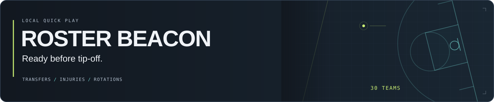
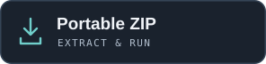
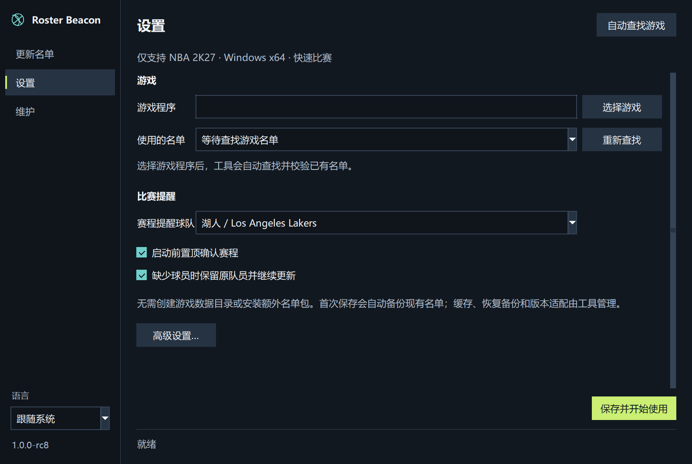
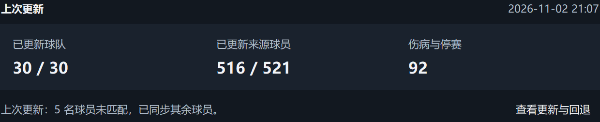
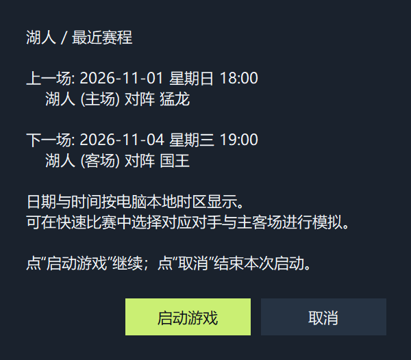

**[English](README.md)** · **简体中文**

开赛前更新转会、伤停和出场顺序，一次处理全部 30 队。

**NBA 2K27 · Windows 10/11 x64 · 仅快速比赛**  
独立第三方工具。其他游戏代际和平台不受支持；已实现 Steam 路径发现与启动，Steam 游戏内采用修改名单仍待对应机器确认。

[rc9 下载、源码与校验值](https://github.com/c01-in/roster-beacon/releases/tag/v1.0.0-rc9) · [使用说明](docs/安装与部署.md) · [数据来源与使用风险](#数据来源本机请求与使用风险)

rc8 真实首次设置。选择游戏即可，缓存、恢复备份和版本适配由工具管理；画面未展示个人路径。

## 三步，准备开赛

1. **选择游戏。** 安装工具或完整解压便携包，自动查找游戏，或选中 `NBA2K27.exe`。
2. **保存并开始使用。** 工具自动寻找、校验已有名单；存在多份兼容存档时选择正在用的那份，首次保存自动建立恢复备份。
3. **更新后开赛。** 点击“仅更新名单”或“更新并启动”，首次阅读并确认来源说明；启用赛程提醒时，启动前再确认最近对阵。

无需创建 SYNC 文件夹、选择缓存路径或安装额外名单包。没有找到可用名单时，先打开游戏进入主菜单、退出，再点“重新查找”。游戏可以不连接 2K 服务器，电脑需要联网访问所配置的数据源。

## 一次处理全部 30 队

| 比赛前能做什么 | 工具如何处理 |
| --- | --- |
| **转会与伤停** | 更新全联盟中能唯一匹配的真实球员所属球队、伤病和停赛状态。 |
| **首发与替补顺序** | 依照来源深度表按位置组成阵容，新生成的活跃轮换排除 Out 和停赛球员。 |
| **最近的对阵** | 启动前展示提醒球队上一场与下一场比赛、对手及主客场。 |
| **自动管理恢复备份** | 备份已有数据、校验后提交，更新失败阻止启动；普通保存设置保留恢复备份。 |

### 更新了什么，保留了什么，一眼看清

来自 2026 年 11 月 2 日（美国太平洋时间）一次真实本地更新的界面局部。统计随本地名单与来源变化，这不是实时状态。

### 先选最近对阵，再进入游戏

同次运行保存的赛程示例，由 rc8 真实弹窗重显，并非实时赛程推送。图中时间按美国太平洋时区显示。

## 使用已有名单，缺员时合理回退

直接使用游戏已有、兼容的**未加密 SYNC RDAT v9** 名单。RDAT v9 是数据格式，不是需要下载的包。工具不附带游戏文件、名单包、面补、模型，也不会凭空创建球员记录。

缺少来源球员时可保留本队其他真实队员补位；整队无法匹配或无法组成安全阵容时，可保留原名单，相关转会按需暂缓以避免重复。保留数据与已更新数据分别报告，旧快照不冒充当前状态。严格模式在缺员时停止；输入损坏、布局不兼容或来源失败也会停止。

**仅快速比赛：**不支持个人生涯、MyNBA／王朝／赛季存档或游戏内热更新。手动路径、其他本机导入来源和版本适配仍在“高级设置”中。补齐真正缺少的球员记录，需要使用有权使用的兼容本地名单更新并明确重新导入。[详细规则与限制 →](docs/zh-CN/ROSTER-DATA.md)

## 数据来源、本机请求与使用风险

默认数据源是 **ESPN**。名单、伤病、轮换和赛程请求由你的电脑直接发往配置的数据源，不经过 Roster Beacon 服务器；弹窗显示实际接口地址。数据并非 NBA／2K 官方名单推送，工具与 ESPN、NBA、2K、Take-Two、Valve 无隶属关系。

- **数据采集：**ESPN 适用条款限制未经明确许可的自动获取，本项目尚未取得相应许可。[来源条款](https://disneytermsofuse.com/english/)。
- **游戏修改：**Take-Two 条款限制外部修改和部分相关工具，包含条款所述例外；可能产生条款争议、下架要求或账号措施。[游戏条款](https://www.take2games.com/legal/en-US/)。

首次请求或改动名单前，选择“我已了解，自愿继续”或“取消”。取消会在本次请求、名单写入与游戏启动前结束操作。确认只保存在本机，绑定配置、来源、适配档案和说明版本；“维护 → 关于”可再次查看说明或撤回确认。仅使用本地缓存和恢复基准时不获取数据。

确认记录自愿选择，不代表数据源或游戏厂商授权，也未承诺账号安全。[实际实现与条款核查 →](docs/legal/IMPLEMENTATION-REVIEW.md)

## 文档与开发

[设置和恢复](docs/SETUP.md) · [缺员处理](docs/zh-CN/ROSTER-DATA.md) · [中文文档索引](docs/README.zh-CN.md) · [更新记录](docs/zh-CN/CHANGELOG.md) · [参与贡献](docs/zh-CN/CONTRIBUTING.md)

源码运行与高级配置

需要 Windows、Python 3.12 x64 与 `requirements.txt`，运行 `python app_main.py`。`scripts/build_windows.ps1` 复用已有 PyInstaller／Inno Setup，显式指定缓存及输出目录；GitHub 构建 workflow 只按需执行，不自动发布。

为兼容升级，设置仍位于 `%APPDATA%\NBA-Roster-Sync\settings.json`，`NBA_ROSTER_SYNC_CONFIG` 可指定其他配置。默认跟随 Windows 显示语言，也可用左下角切换。控制台支持 `--settings`、`--launch`、`--update-only`、`--restore`、`--diagnose` 和 `--import-baseline`。详细配置、恢复与格式限制见使用说明。

## 许可

[MIT](LICENSE) 覆盖贡献者拥有权利的原创代码和图形；运行库保留各自的[许可与声明](docs/zh-CN/THIRD_PARTY_NOTICES.md)。游戏内容、名单包、数据源内容和商标不属于这项授权。致谢与免责声明不会授予第三方许可。[截图与图形来源记录](assets/readme/README.md)。

## 权利人联系与下架处理

[提交权利问题／下架请求](https://github.com/c01-in/roster-beacon/issues/new?template=rights_concern.yml)，或使用“维护 → 关于 → 权利人联系”。请指出涉及的功能、文件、网址或版本，相关权利或条款，以及希望采取的措施。公开 issue 请勿包含机密证据或个人信息；敏感安全问题请使用[私密漏洞报告](https://github.com/c01-in/roster-beacon/security/advisories/new)。

我们会优先暂停相关分发或功能，核查并及时移除、限制或修正涉及内容。处理范围是维护者控制的版本和下载入口，已经下载的副本无法统一收回。配合下架不会自动取得第三方授权，也不构成免除责任的保证。
